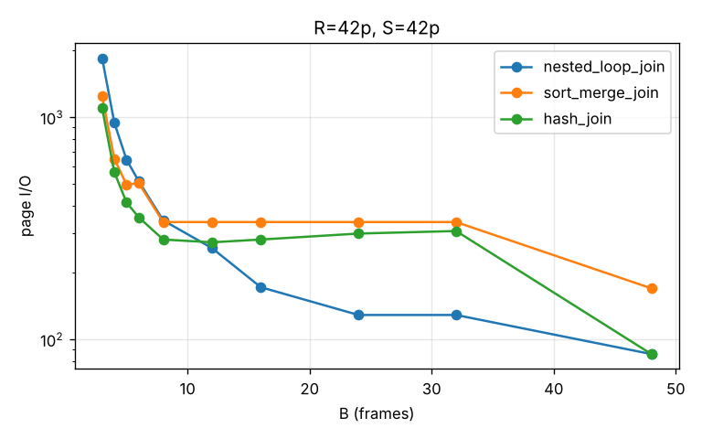

# REPORT_M2: Execution engine measurements

Machines: the tables were produced on Linux (Intel Xeon 2.10 GHz, 2 cores, 7 GB RAM, Python 3.13.18). The test suite also passes on my Windows PC (8 logical processors, Python 3.13.14). Page counts and comparisons are deterministic, so they do not depend on the machine; wall-clock seconds do.

All numbers come from `python tools/m2_measure.py --out results_m2`, which builds its
own relations (tuples of 4 + 4 + 152 bytes, about 25 per page, keys uniform unless
stated), runs each plan through `execution.engine.execute` on a cold buffer pool of
exactly B frames, and writes `results_m2/REPORT_M2_tables.md`, `join_costs.csv` and the
two plots.

## 1. Join cost against the formula

Formulas (M2 spec §2): BNL `M + ceil(M/(B-2))·N`; sort-merge `sort(M) + sort(N) + M + N`
with `sort(X) = 2X(passes-1) + X`; hash `3(M + N)`. M and N are data pages. "Measured" is
reads + writes over every operator in the plan, the scans included, so it also counts each
scan's directory page.

| join | M | N | B | measured reads | measured writes | measured total | formula | difference | comparisons |
|---|---|---|---|---|---|---|---|---|---|
| nested_loop_join | 11 | 11 | 4 | 84 | 0 | 84 | 77 | +7 | 62500 |
| nested_loop_join | 11 | 11 | 16 | 24 | 0 | 24 | 22 | +2 | 62500 |
| nested_loop_join | 11 | 11 | 64 | 24 | 0 | 24 | 22 | +2 | 62500 |
| nested_loop_join | 11 | 11 | 256 | 24 | 0 | 24 | 22 | +2 | 62500 |
| sort_merge_join | 11 | 11 | 4 | 105 | 33 | 138 | 88 | +50 | 5177 |
| sort_merge_join | 11 | 11 | 16 | 35 | 11 | 46 | 44 | +2 | 4953 |
| sort_merge_join | 11 | 11 | 64 | 24 | 0 | 24 | 44 | -20 | 4953 |
| sort_merge_join | 11 | 11 | 256 | 24 | 0 | 24 | 44 | -20 | 4953 |
| hash_join | 11 | 11 | 4 | 77 | 25 | 102 | 66 | +36 | 20850 |
| hash_join | 11 | 11 | 16 | 24 | 0 | 24 | 66 | -42 | 990 |
| hash_join | 11 | 11 | 64 | 24 | 0 | 24 | 66 | -42 | 990 |
| hash_join | 11 | 11 | 256 | 24 | 0 | 24 | 66 | -42 | 990 |
| nested_loop_join | 32 | 32 | 4 | 561 | 0 | 561 | 544 | +17 | 562500 |
| nested_loop_join | 32 | 32 | 16 | 132 | 0 | 132 | 128 | +4 | 562500 |
| nested_loop_join | 32 | 32 | 64 | 66 | 0 | 66 | 64 | +2 | 562500 |
| nested_loop_join | 32 | 32 | 256 | 66 | 0 | 66 | 64 | +2 | 562500 |
| sort_merge_join | 32 | 32 | 4 | 502 | 160 | 662 | 384 | +278 | 18320 |
| sort_merge_join | 32 | 32 | 16 | 162 | 96 | 258 | 256 | +2 | 17151 |
| sort_merge_join | 32 | 32 | 64 | 98 | 32 | 130 | 128 | +2 | 17158 |
| sort_merge_join | 32 | 32 | 256 | 66 | 0 | 66 | 128 | -62 | 17158 |
| hash_join | 32 | 32 | 4 | 299 | 66 | 365 | 192 | +173 | 188133 |
| hash_join | 32 | 32 | 16 | 141 | 75 | 216 | 192 | +24 | 3388 |
| hash_join | 32 | 32 | 64 | 66 | 0 | 66 | 192 | -126 | 4028 |
| hash_join | 32 | 32 | 256 | 66 | 0 | 66 | 192 | -126 | 4028 |
| nested_loop_join | 105 | 105 | 4 | 5724 | 0 | 5724 | 5670 | +54 | 6250000 |
| nested_loop_join | 105 | 105 | 16 | 954 | 0 | 954 | 945 | +9 | 6250000 |
| nested_loop_join | 105 | 105 | 64 | 318 | 0 | 318 | 315 | +3 | 6250000 |
| nested_loop_join | 105 | 105 | 256 | 212 | 0 | 212 | 210 | +2 | 6250000 |
| sort_merge_join | 105 | 105 | 4 | 1798 | 735 | 2533 | 1680 | +853 | 72558 |
| sort_merge_join | 105 | 105 | 16 | 527 | 315 | 842 | 840 | +2 | 82286 |
| sort_merge_join | 105 | 105 | 64 | 527 | 315 | 842 | 840 | +2 | 66410 |
| sort_merge_join | 105 | 105 | 256 | 212 | 0 | 212 | 420 | -208 | 66338 |
| hash_join | 105 | 105 | 4 | 2202 | 212 | 2414 | 630 | +1784 | 2082298 |
| hash_join | 105 | 105 | 16 | 436 | 224 | 660 | 630 | +30 | 12924 |
| hash_join | 105 | 105 | 64 | 477 | 265 | 742 | 630 | +112 | 11961 |
| hash_join | 105 | 105 | 256 | 212 | 0 | 212 | 630 | -418 | 10555 |

### Explaining the differences

**Block nested loop: always formula + (1 + number of blocks).** Every heap scan starts
by reading the table's directory page (page 0), which the formula does not count: one for
the outer scan and one for each restart of the inner scan, i.e. one per outer block.
M = 105, B = 4: ceil(105/2) = 53 blocks, so +54, exactly the measured gap; at B = 256 one
block, +2. Comparisons are 6 250 000 = 2 500 × 2 500 at every B: every pair is compared,
because a match is unknown until it is compared; B only changes how often the inner is
re-read.

**Hash join, middle B: formula + a little.** It partitions into P = B − 1 partitions as
the spec says. Each partition's last page is only partly full, so the partitions take a
few more pages than M + N, and each is written once and read once. At B = 16 that is 224
partition pages against 210 (+30 in total with the directory pages). At B = 64 it is 63
partitions for 105 pages, under two pages each, so the partly-full last pages add up
(265 written, +112): the formula assumes a partition costs exactly its share of M.

**Hash join, large B: below the formula.** When the build side fits in the working
frames my join builds the table in memory and never partitions (DESIGN_M2.md §4), so it
reads each input once: M + N + 2 = 212 at B = 256 against 630. The formula assumes
partitioning always happens.

**Hash join, B = 4: far above the formula** (2414 against 630). Three partitions of about
35 pages each cannot fit in the 3-frame table, so every partition overflows and that pair
falls back to block nested loop (the `overflowed_partitions` field), and its re-reads
dominate. 3(M + N) assumes each partition fits in memory, which needs roughly B ≥ √M;
at B = 4 it does not. The 2 082 298 comparisons are that nested-loop work.

**Sort-merge, middle B: formula + 2** (the two directory pages). Each sort uses B run
frames and (B − 1)-way merges, exactly the spec's sort, so the pass counts and the page
counts are the formula's.

**Sort-merge, large B: below the formula.** At B = 256 both inputs fit in memory, nothing
is written, and the cost is the two scans (212). The formula's `sort(X) = X` for an input
that fits charges a read of X on top of the join's own `+ M + N`, so it counts each input
twice.

**Sort-merge, B = 4: above** (2533 against 1680). Two reasons. The right input has to be
rewindable, so it is merged into one run file instead of streamed, which is one more write
and read of N that the formula does not have. And every rewind to the start of a run of
equal keys that crosses a page boundary re-reads that page: with all four frames in use
(three for the left merge, one for the right cursor) nothing else stays cached, so those
re-reads go to disk. Keys repeat about four times per side here, so this happens often.

## 2. External sort passes

| N pages | B | runs after pass 0 | measured passes | formula 1+ceil(log(ceil(N/B))/log(B-1)) | reads | writes | peak frames |
|---|---|---|---|---|---|---|---|
| 8 | 3 | 3 | 3 | 3 | 23 | 14 | 3 |
| 80 | 4 | 20 | 4 | 4 | 313 | 232 | 4 |
| 160 | 8 | 20 | 3 | 3 | 481 | 320 | 8 |
| 64 | 16 | 4 | 2 | 2 | 129 | 64 | 16 |
| 100 | 5 | 20 | 4 | 4 | 381 | 280 | 5 |
| 320 | 16 | 20 | 3 | 3 | 961 | 640 | 16 |
| 40 | 4 | 10 | 4 | 4 | 153 | 112 | 4 |

Measured passes equal the formula in all seven cases, including N = 80 at B = 4 (20 × B).
Pass 0 uses B frames for each run: the sort reserves B − 1, and the page the scan is
reading is the B-th (DESIGN_M2.md §3), so there are ceil(N/B) runs. Merges are (B − 1)-way
with one output frame.

Reads and writes also follow the formula 2N(passes − 1) + N, plus the scan's directory
page. The spec's worked example (N = 8, B = 3): 3 runs, pass 1 merges two and carries the
third, pass 2 streams the last two. Reads are 8 + 6 + 8 = 22 (23 here, with the directory
page) and writes 8 + 6 = 14, exactly the spec's table. N = 80, B = 4: 20 runs, then 7,
then 3, then the final streaming merge. That is 4 passes and 232 writes, not 3 × 80 = 240,
because runs carried forward untouched are not rewritten.

## 3. Crossover

### 3a. Fixed relations, varying B

R = 42 pages, S = 42 pages.

| B | nested_loop_join | sort_merge_join | hash_join | cheapest |
|---|---|---|---|---|
| 3 | 1849 | 1244 | 1102 | hash_join |
| 4 | 946 | 651 | 566 | hash_join |
| 5 | 645 | 498 | 414 | hash_join |
| 6 | 516 | 506 | 355 | hash_join |
| 8 | 344 | 338 | 282 | hash_join |
| 12 | 258 | 338 | 274 | nested_loop_join |
| 16 | 172 | 338 | 282 | nested_loop_join |
| 24 | 129 | 338 | 300 | nested_loop_join |
| 32 | 129 | 338 | 308 | nested_loop_join |
| 48 | 86 | 170 | 86 | nested_loop_join |

### 3b. Fixed B = 8, varying size (R and S the same size)

| pages each | nested_loop_join | sort_merge_join | hash_join | cheapest |
|---|---|---|---|---|
| 3 | 8 | 8 | 8 | nested_loop_join |
| 7 | 24 | 30 | 54 | nested_loop_join |
| 17 | 72 | 138 | 114 | nested_loop_join |
| 38 | 312 | 306 | 240 | hash_join |
| 63 | 768 | 730 | 515 | hash_join |

**Varying B (42 × 42 pages).** Hash join is cheapest from B = 3 to B = 8, and nested
loop from B = 12 on.
- *Small B:* nested loop has to re-read S ceil(42/(B − 2)) times (42 times at B = 3),
  while hash join and sort-merge read and write each input a fixed number of times.
  Hash join wins because it needs one partitioning pass, where sort-merge needs a full
  external sort of both sides.
- *B ≥ 12:* the outer fits in ceil(42/10) = 5 blocks or fewer, and nested loop's cost
  drops fast (B = 24: 2 blocks, 129). Hash join is stuck near its 3(M + N) floor until
  the build side fits in memory.
- *B = 48:* the build side fits, hash join drops to M + N = 86 and ties nested loop,
  which also needs a single block: both just read each input once.

The crossover from hash to nested loop is where `ceil(M/(B−2))·N` falls below the hash
join's partition-and-reread cost, here between B = 8 and B = 12.

**Varying size at B = 8.** Nested loop wins while the outer fits in a few blocks of 6
pages (up to 17 pages: 3 blocks). From 38 pages on, its cost grows like M × N / 6 while
hash join grows linearly, and hash join takes over.

**What causes the crossover:** nested loop is quadratic in pages, but its constant shrinks
as B grows. Hash join and sort-merge are linear but pay to write and re-read their inputs.
Small B or large inputs favour the linear algorithms; enough memory to hold the outer in a
few blocks favours nested loop.

## 4. Skew

40% of the rows on both sides have key 7; the rest are uniform over 0..999. Hash join at B = 16.

**uniform**: partitions (left pages) [5, 5, 5, 4, 5, 4, 5, 5, 4, 4, 5, 5, 5, 4, 5], (right pages) [4, 5, 4, 5, 5, 5, 5, 5, 5, 5, 4, 6, 4, 4, 5], overflowed partitions [], reads 269, writes 141, comparisons 4220, output 2263 rows, 0.03 s

**skewed**: partitions (left pages) [3, 3, 3, 3, 3, 3, 4, 27, 3, 3, 4, 3, 3, 3, 3], (right pages) [3, 3, 3, 3, 3, 2, 3, 28, 4, 3, 3, 3, 2, 3, 3], overflowed partitions [7], reads 312, writes 140, comparisons 433191, output 358257 rows, 0.21 s

With 40 % of the keys equal to 7, h1 sends all of them to one partition. Partition 7
holds 27 left pages and 28 right pages, about nine times its neighbours, and more than the
15-frame table. My overflow handling (DESIGN_M2.md §4) detects it when the build table
fills, and joins that one pair by block nested loop (blocks of 14 pages of L₇, R₇ re-read
per block). Re-partitioning would not help: every tuple of the hot key hashes to the same
partition at every depth.

Cost against the uniform case: writes are the same (140 against 141), because partitioning
does not depend on skew. Reads rise from 269 to 312: those are the re-reads of R₇.
Comparisons jump from 4 220 to 433 191, but the output itself grew from 2 263 to 358 257
rows, since about 600 × 600 tuples share key 7. Most of the extra work is producing a
genuinely larger result; the overflow's own overhead is the 43 extra page reads.

## 5. The budget

Sort of 80 pages (20 x B) at B = 4: completed, 4 passes, 313 reads, 232 writes. Largest number of frames held at once (pinned + reserved, BufferPool.peak_held): **4**.

How I know: the plan runs over a buffer pool of exactly B frames, and the tuples the sort
keeps are held in frames *reserved* from that pool (DESIGN_M2.md §2), so pinned + reserved
can never exceed B. `BufferPool.peak_held` records the maximum of pinned + reserved after
every fetch and reservation. The test `tests/test_m2.py::SortTests::test_sort_20_times_B_at_B4`
asserts the same, and every test also checks that nothing is pinned or reserved and no temp
file remains after close.

## Sources

- **Shapiro, TODS 1986** (DESIGN_M2.md §9): hybrid hashing, building in memory when the
  build side fits, is why hash join drops below 3(M + N) at large B in §1, and his
  "partitions must fit in memory" condition is the B ≳ √M explanation of B = 4.
- **Ramakrishnan and Gehrke, ch. 13–14** (external sorting, joins): the cost formulas
  in the tables are theirs and the spec's; their observation that block nested loop wins
  once the outer fits in a few blocks is the crossover in §3a.
