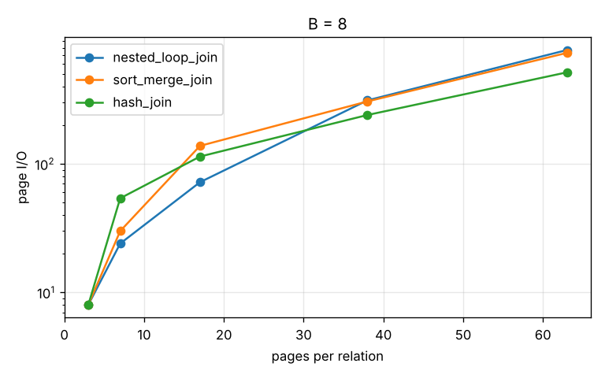

# REPORT_M2 — Execution engine measurements

Machines: the tables were produced on Linux (Intel Xeon 2.10 GHz, 2 cores, 7 GB RAM, Python 3.13.18) and the tools were rerun on my Windows PC (8 logical processors, Python 3.13.14). Page counts and comparisons are deterministic and identical on both; only wall-clock seconds differ.
All numbers come from `python tools/m2_measure.py --out results_m2`, which builds its
own relations (tuples of 4 + 4 + 152 bytes, about 25 per page, keys uniform unless
stated), runs each plan through `execution.engine.execute` on a cold buffer pool of
exactly B frames, and writes `results_m2/REPORT_M2_tables.md`, `join_costs.csv` and the
two plots. Page counts and comparisons are deterministic; only wall times vary by machine.

## 1. Join cost against the formula

Formulas (M2 spec §2): BNL `M + ceil(M/(B-2))·N`; sort-merge
`sort(M) + sort(N) + M + N` with `sort(X) = 2X(passes-1) + X`; hash `3(M + N)`.
M, N are data pages; "measured" is reads + writes summed over every operator in the plan,
the scans included.

M, N are data pages. Measured reads include each scan's directory page.

| join | M | N | B | measured reads | measured writes | measured total | formula | difference | comparisons |
|---|---|---|---|---|---|---|---|---|---|
| nested_loop_join | 11 | 11 | 4 | 84 | 0 | 84 | 77 | +7 | 62500 |
| nested_loop_join | 11 | 11 | 16 | 24 | 0 | 24 | 22 | +2 | 62500 |
| nested_loop_join | 11 | 11 | 64 | 24 | 0 | 24 | 22 | +2 | 62500 |
| nested_loop_join | 11 | 11 | 256 | 24 | 0 | 24 | 22 | +2 | 62500 |
| sort_merge_join | 11 | 11 | 4 | 95 | 71 | 166 | 88 | +78 | 5096 |
| sort_merge_join | 11 | 11 | 16 | 35 | 11 | 46 | 44 | +2 | 4953 |
| sort_merge_join | 11 | 11 | 64 | 24 | 0 | 24 | 44 | -20 | 4953 |
| sort_merge_join | 11 | 11 | 256 | 24 | 0 | 24 | 44 | -20 | 4953 |
| hash_join | 11 | 11 | 4 | 77 | 23 | 100 | 66 | +34 | 31172 |
| hash_join | 11 | 11 | 16 | 24 | 0 | 24 | 66 | -42 | 990 |
| hash_join | 11 | 11 | 64 | 24 | 0 | 24 | 66 | -42 | 990 |
| hash_join | 11 | 11 | 256 | 24 | 0 | 24 | 66 | -42 | 990 |
| nested_loop_join | 32 | 32 | 4 | 561 | 0 | 561 | 544 | +17 | 562500 |
| nested_loop_join | 32 | 32 | 16 | 132 | 0 | 132 | 128 | +4 | 562500 |
| nested_loop_join | 32 | 32 | 64 | 66 | 0 | 66 | 64 | +2 | 562500 |
| nested_loop_join | 32 | 32 | 256 | 66 | 0 | 66 | 64 | +2 | 562500 |
| sort_merge_join | 32 | 32 | 4 | 354 | 288 | 642 | 384 | +258 | 17182 |
| sort_merge_join | 32 | 32 | 16 | 162 | 96 | 258 | 256 | +2 | 18086 |
| sort_merge_join | 32 | 32 | 64 | 98 | 32 | 130 | 128 | +2 | 17158 |
| sort_merge_join | 32 | 32 | 256 | 66 | 0 | 66 | 128 | -62 | 17158 |
| hash_join | 32 | 32 | 4 | 376 | 64 | 440 | 192 | +248 | 281046 |
| hash_join | 32 | 32 | 16 | 133 | 67 | 200 | 192 | +8 | 3567 |
| hash_join | 32 | 32 | 64 | 66 | 0 | 66 | 192 | -126 | 4028 |
| hash_join | 32 | 32 | 256 | 66 | 0 | 66 | 192 | -126 | 4028 |
| nested_loop_join | 105 | 105 | 4 | 5724 | 0 | 5724 | 5670 | +54 | 6250000 |
| nested_loop_join | 105 | 105 | 16 | 954 | 0 | 954 | 945 | +9 | 6250000 |
| nested_loop_join | 105 | 105 | 64 | 318 | 0 | 318 | 315 | +3 | 6250000 |
| nested_loop_join | 105 | 105 | 256 | 212 | 0 | 212 | 210 | +2 | 6250000 |
| sort_merge_join | 105 | 105 | 4 | 1555 | 1343 | 2898 | 1680 | +1218 | 67179 |
| sort_merge_join | 105 | 105 | 16 | 527 | 315 | 842 | 840 | +2 | 86374 |
| sort_merge_join | 105 | 105 | 64 | 527 | 315 | 842 | 840 | +2 | 66338 |
| sort_merge_join | 105 | 105 | 256 | 212 | 0 | 212 | 420 | -208 | 66338 |
| hash_join | 105 | 105 | 4 | 3105 | 210 | 3315 | 630 | +2685 | 3124696 |
| hash_join | 105 | 105 | 16 | 428 | 216 | 644 | 630 | +14 | 12573 |
| hash_join | 105 | 105 | 64 | 424 | 212 | 636 | 630 | +6 | 12624 |
| hash_join | 105 | 105 | 256 | 212 | 0 | 212 | 630 | -418 | 10555 |

### Explaining the differences

**Block nested loop: always formula + (1 + number of blocks).** Every heap scan
starts by reading the table's directory page (page 0), which the formula does not
count: one for the outer scan and one for each restart of the inner scan, i.e. one per
outer block. M = 105, B = 4: ceil(105/2) = 53 blocks, so 1 + 53 = +54, exactly the
measured gap; at B = 256 one block, +2. The comparison count is 6 250 000 = 2 500 × 2 500
at every B: every pair is compared because a match is unknown until it is compared, and
B only changes how often the inner is re-read.

**Hash join, B = 16 and 64: formula + a few.** Partitioning writes each partition's last
page partly full, so Σ partition pages is slightly more than M + N (216 written against
210 at M = N = 105, B = 16), and each is read back once; plus the two directory pages.

**Hash join, large B: below the formula.** When the build side fits in the B − 2 working
frames my join does not partition at all (DESIGN_M2.md §4): it reads both inputs once,
M + N + 2 (212 at B = 256 against a formula of 630). The formula assumes Grace
partitioning always happens.

**Hash join, B = 4: far above the formula** (3315 against 630). Two working frames give
two partitions of about 52 pages each, far more than the 2-frame table, so every
partition overflows and falls back to block nested loop on that pair (the
`overflowed_partitions` field), whose re-reads dominate. 3(M + N) assumes each partition
fits in memory, which needs roughly B ≥ √M; at B = 4 it does not. The 3 124 696
comparisons show the same thing: nested-loop work inside each partition.

**Sort-merge, middle B: formula + 2.** My sort uses B − 1 run frames, but where the
input needs exactly one merge pass the pass count matches the formula, and the +2 is the
two directory pages. **Large B: below the formula**: at B = 256 both sorted inputs fit in
memory, nothing is written, and the cost is just the two scans (212); the formula's
`sort(X) = X` for an input that fits still charges a read of X on top of the scan's own
M, so it counts each input twice. **B = 4: above** (2898 against 1680): with W = 3
run frames and 2-way merges the sort needs more passes than the formula's 3-way
(`1 + ceil(log(ceil(105/4))/log 3)`), and each extra pass costs 2M; in addition the right
input is merged into one rewindable run file (DESIGN_M2.md §4), one more write and read.

## 2. External sort passes

W = B - 1 working frames (one frame is the input page, DESIGN_M2.md 3). Own formula: runs0 = ceil(N/W); passes = 1 + (merge passes with fan-in W-1 until <= W runs) + 1.

| N pages | B | runs after pass 0 | measured passes | spec formula 1+ceil(log(ceil(N/B))/log(B-1)) | own formula | reads | writes | peak frames |
|---|---|---|---|---|---|---|---|---|
| 8 | 3 | 4 | 3 | 3 | 3 | 25 | 16 | 3 |
| 80 | 4 | 27 | 6 | 4 | 6 | 471 | 390 | 4 |
| 160 | 8 | 23 | 3 | 3 | 3 | 481 | 320 | 8 |
| 64 | 16 | 5 | 2 | 2 | 2 | 129 | 64 | 16 |
| 100 | 5 | 25 | 4 | 4 | 4 | 397 | 296 | 5 |
| 320 | 16 | 22 | 3 | 3 | 3 | 961 | 640 | 16 |
| 40 | 4 | 14 | 5 | 4 | 5 | 197 | 156 | 4 |

The spec's formula assumes B frames for each run and (B − 1)-way merges. Mine has
W = B − 1 run frames, because the scan feeding the sort holds the page it is reading,
and therefore (B − 2)-way intermediate merges with one frame for output (DESIGN_M2.md §3).
The two agree in five of the seven cases. They disagree at B = 4 (N = 80, 20 × B, and
N = 40): with only 2-way merges the 27 runs need ceil(log₂(27/3)) more passes than the
spec's 3-way merge of ceil(80/4) = 20 runs, so 6 passes against 4. My own formula
matches every measurement, which is the check that the implementation does what the
design says. Writes confirm it: N per pass that writes (N = 80: 5 writing passes ×
80 = 400, minus 10 for runs carried forward untouched = 390).

## 3. Crossover

### 3a. Fixed relations, varying B

R = 42 pages, S = 42 pages.

| B | nested_loop_join | sort_merge_join | hash_join | cheapest |
|---|---|---|---|---|
| 3 | 1849 | 1548 | 1976 | sort_merge_join |
| 4 | 946 | 954 | 660 | hash_join |
| 5 | 645 | 818 | 448 | hash_join |
| 6 | 516 | 578 | 370 | hash_join |
| 8 | 344 | 506 | 332 | hash_join |
| 12 | 258 | 338 | 260 | nested_loop_join |
| 16 | 172 | 338 | 262 | nested_loop_join |
| 24 | 129 | 338 | 260 | nested_loop_join |
| 32 | 129 | 338 | 260 | nested_loop_join |
| 48 | 86 | 170 | 86 | nested_loop_join |

### 3b. Fixed B = 8, varying size (R and S the same size)

| pages each | nested_loop_join | sort_merge_join | hash_join | cheapest |
|---|---|---|---|---|
| 3 | 8 | 8 | 8 | nested_loop_join |
| 7 | 24 | 58 | 48 | nested_loop_join |
| 17 | 72 | 138 | 110 | nested_loop_join |
| 38 | 312 | 458 | 279 | hash_join |
| 63 | 768 | 746 | 493 | hash_join |

**Varying B (42 × 42 pages).** The ranking changes twice.
- *B = 3*: sort-merge is cheapest. With one working frame the hash join's single
  partition overflows into nested loop, and nested loop itself re-reads S 42 times.
- *B = 4 to 8*: hash join. It costs about 3(M + N) once partitions fit, while nested
  loop still needs ceil(42 / (B − 2)) passes over S.
- *B ≥ 12*: nested loop. The outer now fits in ceil(42/10) ≤ 5 blocks and falls fast
  (B = 24: 2 blocks, 129), while hash join is stuck at its 3(M + N) floor until the
  build side fits in memory. At B = 48 the build side fits, hash join drops to
  M + N = 86 and ties nested loop, which also needs a single block: both just read each
  input once. The crossover from hash to nested loop is where
  `ceil(M/(B−2))·N` falls below `2(M + N)`, here between B = 8 and B = 12.

**Varying size at B = 8.** Nested loop wins while the outer fits in a few blocks of 6
pages (up to 17 pages: 3 blocks); from 38 pages on, its cost grows as M × N / 6 while
hash join grows linearly, and hash join takes over. Sort-merge is never cheapest here
because each input needs two or more passes of external sort at B = 8.

**What causes the crossover:** nested loop is quadratic in pages but its constant
shrinks with B; hash and sort-merge are linear but pay to write and re-read their inputs
at least once. Small B or large inputs favour the linear algorithms; enough memory to
hold the outer in a few blocks favours nested loop.

## 4. Skew

40% of the rows on both sides have key 7; the rest are uniform over 0..999. Hash join at B = 16.

**uniform**: partitions (left pages) [12, 12, 10, 10, 11, 11], (right pages) [10, 11, 11, 11, 11, 11], overflowed partitions [], reads 259, writes 131, comparisons 4393, output 2263 rows, 0.04 s

**skewed**: partitions (left pages) [7, 7, 6, 6, 31, 8], (right pages) [6, 6, 6, 7, 32, 8], overflowed partitions [4], reads 337, writes 130, comparisons 561547, output 358257 rows, 0.33 s

With 40 % of the keys equal to 7, h1 sends all of them to one partition: partition 4
holds 31 left pages and 32 right pages, five times its neighbours and larger than the
14-frame table. My overflow handling (DESIGN_M2.md §4) detects it when the build table
fills, and joins that one pair by block nested loop (blocks of 14 pages of L₄, R₄
re-read per block, 3 times here). Re-partitioning would not help: every tuple of the
hot key hashes to the same partition at every depth.

Cost against the uniform case: writes are the same (130 against 131: partitioning cost
does not depend on skew), reads rise from 259 to 337 (the re-reads of R₄), and
comparisons jump from 4 393 to 561 547 — but the output itself grew from 2 263 to
358 257 rows, since 600 × 600 tuples share key 7. Most of the extra work is producing
a genuinely larger result; the overflow's own overhead is the 78 extra page reads.

## 5. The budget

Sort of 80 pages (20 x B) at B = 4: completed, 6 passes, 471 reads, 390 writes. Largest number of frames held at once (pinned + reserved, BufferPool.peak_held): **4**.

How I know: the plan runs over a buffer pool of exactly B frames, and the tuples the
sort keeps are held in frames *reserved* from that pool (DESIGN_M2.md §2), so
pinned + reserved can never exceed B; `BufferPool.peak_held` records the maximum of
pinned + reserved after every fetch and reservation. The test
`tests/test_m2.py::SortTests::test_sort_20_times_B_at_B4` asserts the same, and every
test also checks that nothing is pinned or reserved and no temp file remains after close.

## Sources

- **Shapiro, TODS 1986** (DESIGN_M2.md §9): hybrid hashing, building in memory when the
  build side fits, is why hash join drops below 3(M + N) at large B in §1, and his
  "partitions must fit in memory" condition is the B ≳ √M explanation of B = 4.
- **Ramakrishnan and Gehrke, ch. 13–14** (external sorting, joins): the cost formulas
  in the tables are theirs and the spec's; their observation that block nested loop wins
  once the outer fits in a few blocks is the crossover in §3a.
